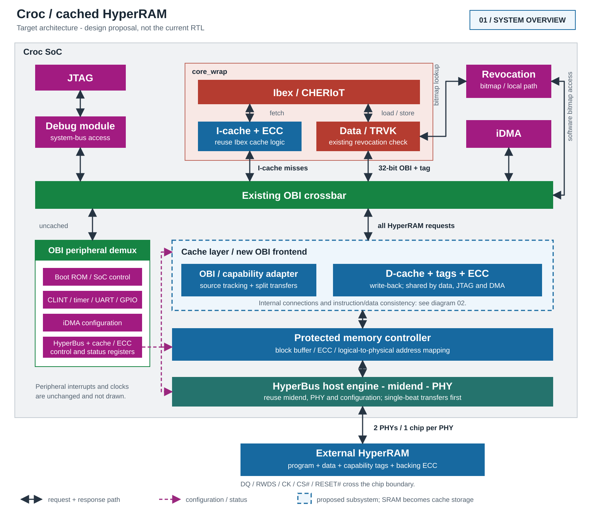
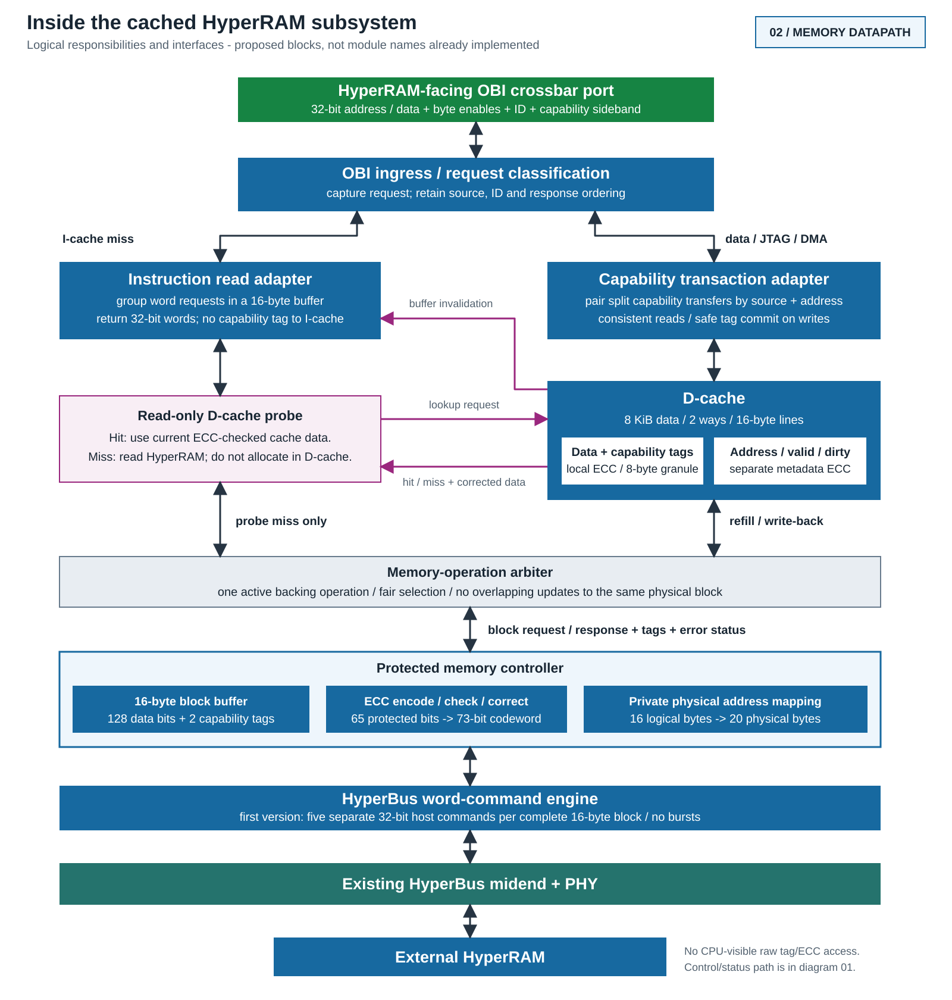

# Cached HyperRAM Architecture Proposal

**Historical illustration.** The diagrams, HTML and PDF below predate the
custom I-cache, two-tag record and current partial-store ECC decisions. Use
[Cache Design Constraints](cache-design-constraints.md) for the current baseline
and [Cache Implementation Status](cache-implementation-status.md) for the RTL
snapshot. The older drawings have not been regenerated to reflect these changes.

**Status: design proposal, not implemented RTL.** This document illustrates the
proposed next architecture with instruction and data caches, capability tags in
HyperRAM, and ECC for both backing memory and cache storage. Initial sizes and
the physical record layout remain design candidates.

- [Illustrated document, including configuration and correctness requirements](hyperram-cache-architecture.html)
- [Printable three-page PDF](hyperram-cache-architecture.pdf)

## System Overview



The I-cache is inside Ibex. Its hits do not enter the OBI crossbar. HyperRAM data,
debug and DMA accesses share the proposed D-cache path. Peripherals and the
revocation bitmap retain their separate paths. The current standalone tag-SRAM
controller is replaced; SRAM becomes cache storage.

Double-headed links represent requests and their matching responses, not two
physical buses. Dashed magenta links are control/status. Interrupts, clock/reset
distribution and user-domain details are omitted from this overview.

## Memory Subsystem Detail



Instruction misses probe the D-cache without allocating in it. A hit supplies
current ECC-checked data; a miss reads backing memory. This is required so an
instruction refill can see code changes still held in a write-back D-cache.
Instruction-cache synchronization is still required after code modifications.

Both caches initially use 16-byte lines. The proposed usable capacities are 4 KiB
for instructions and 8 KiB for data, with two ways each. Backing ECC covers
64 data bits and one capability tag per 8-byte region. Two protected regions are
stored in a 20-byte physical record, representing 16 usable bytes with 25%
storage overhead. Initially each record transfer uses five separate 32-bit host
commands, not a burst.

The illustrated document specifies the split-capability, ECC, boot, debug/DMA,
revocation and maintenance constraints. All new blocks are proposed
responsibilities, not an already verified RTL hierarchy.

## Editable Sources

- [System overview SVG](hyperram-cache-overview.svg)
- [Memory subsystem SVG](hyperram-cache-memory.svg)
- [HTML document source](hyperram-cache-architecture.html)

The SVG files are vector drawings and can be opened directly in a browser or
edited in Inkscape. To regenerate the PDF with Chrome:

```sh
google-chrome --headless --disable-gpu --window-size=1600,1200 \
  --no-pdf-header-footer \
  --print-to-pdf="$PWD/doc/hyperram-cache-architecture.pdf" \
  "file://$PWD/doc/hyperram-cache-architecture.html"
```

Run the command from the repository root. The PDF is generated from the HTML and
the two sibling SVGs. No simulator or firmware build is involved.
